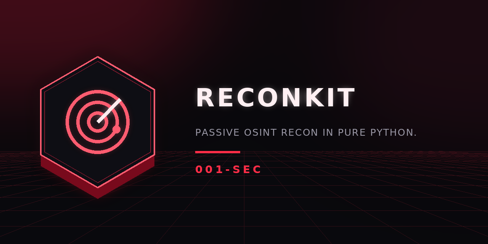

<p align="center">
  
</p>

# reconkit

**Passive OSINT recon for domains.** Single file, Python 3 standard library only, zero dependencies.

<p>
  <a href="https://001-sec.github.io/reconkit/"></a>
  
  
  
</p>

> **Authorized use only.** Passive mode touches only public data sources. Use active mode only on authorized targets. It is a verification instrument for defenders and learners, in the same category as open-source scanners and audit utilities.

## Quickstart

```bash
curl -O https://raw.githubusercontent.com/001-sec/reconkit/main/reconkit.py
python3 reconkit.py --help
```

Landing page: https://001-sec.github.io/reconkit/

Passive OSINT recon for a domain: certificate-transparency subdomains, full DNS records over DNS-over-HTTPS, and TLS certificate details. Standard library only.

## Features
- DNS A / AAAA / MX / NS / TXT / SOA / CAA records via Cloudflare's DoH JSON API (no `dig` needed)
- Subdomain discovery from crt.sh certificate-transparency logs - fully passive, never touches the target
- TLS certificate summary: issuer, validity window, SAN count and sample
- Optional active subdomain brute force (`--subs wordlist`) for authorized targets, clearly separated from the passive mode
- JSON report output for diffing recon over time

## Usage
```
python3 reconkit.py example.com
python3 reconkit.py example.com -o recon.json
python3 reconkit.py example.com --subs wordlists/common.txt   # active mode
```

## Sample output
```
[*] DNS records for example.com (via DNS-over-HTTPS)
    A      104.20.23.154
    MX     0 .
    TXT    "v=spf1 -all"

[*] Certificate-transparency subdomains (crt.sh)
    119 unique name(s)

[*] TLS certificate on example.com:443
    issuer : Cloudflare TLS Issuing ECC CA 3
    expires: Feb 22 23:53:08 2027 GMT
```

## Notes
Passive mode queries only public third-party data sources (crt.sh, Cloudflare DoH) and the target's own TLS handshake. crt.sh can be slow; the tool gives it a 30s floor and degrades gracefully.

## License
MIT, see [LICENSE](LICENSE).

## Contributing

Issues and pull requests are welcome. Keep it dependency-free and single-file.

---

<p align="center">Built by <a href="https://github.com/001-sec">001-sec</a></p>
